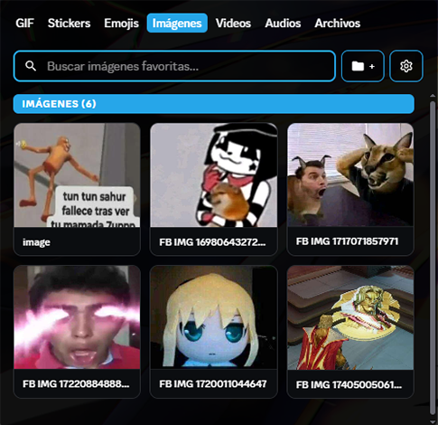
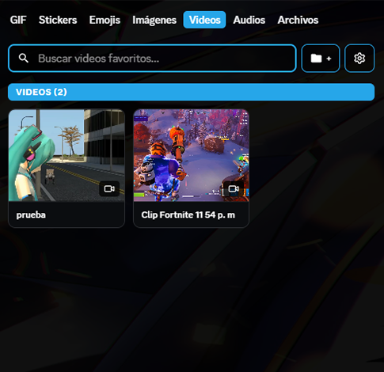
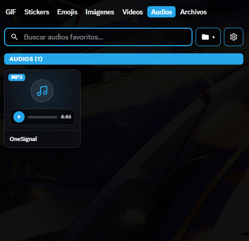
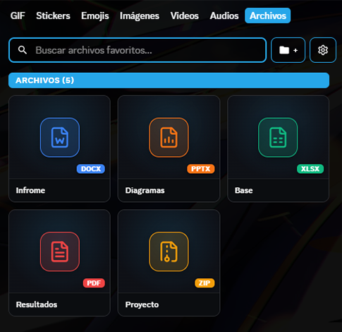

<div align="center">

<p>
  <b><a href="README.md">ESPAÑOL</a></b> &nbsp;•&nbsp; <b><a href="README.en.md">ENGLISH</a></b>
</p>


<br/>
<br/>

**Save, categorize, and send your favorite images, videos, audios, and files on Discord with a single click.**

*Vencord port of the original **FavoriteMedia** plugin created by [Dastan21](https://github.com/Dastan21/BDAddons/tree/d9ae47aa4131fc8e9764af9cd042048d9bb516d8/plugins/FavoriteMedia).*

<br/>

[](https://vencord.dev)
[](https://www.typescriptlang.org/)


</div>

---

## Preview

<table>
  <tr>
    <td align="center" width="50%">
      <b>Images Tab</b><br><br>
      
    </td>
    <td align="center" width="50%">
      <b>Videos Tab</b><br><br>
      
    </td>
  </tr>
  <tr>
    <td align="center" width="50%">
      <b>Audios Tab</b><br><br>
      
    </td>
    <td align="center" width="50%">
      <b>Files Tab</b><br><br>
      
    </td>
  </tr>
</table>

---

## Features

| Module | Description |
| :--- | :--- |
| **Custom Categories** | Folder organization with custom colors and drag-and-drop reordering. |
| **Local Cache (Anti-Dead Links)** | Persistent local storage via **IndexedDB** to prevent broken media when Discord CDN links expire. |
| **Built-in Media Player** | Audio and video previews with playback controls and a dedicated volume slider. |
| **Real-time Search** | Instant filter by name or file format. |
| **Direct Send** | Send directly to the channel with a single click or insert the link into the chat bar. |

---

## Installation

### Step 1: Copy to Vencord
Copy the `FavoriteMedia` folder into the `src/userplugins/` directory of your Vencord repository:
```text
Vencord/
 └── src/
      └── userplugins/
           └── FavoriteMedia/
```

### Step 2: Build & Inject
Run the following commands in your terminal from the root of the Vencord folder:
```bash
pnpm build
pnpm inject
```

### Step 3: Enable the Plugin
1. Open Discord.
2. Go to **User Settings** > **Vencord** section > **Plugins**.
3. Toggle on **`FavoriteMedia`**.
4. Your favorite media panel will be available directly in the chat bar expression picker.

---

## Settings

From the Vencord settings menu you can customize:
* **Sort order:** View newest media first (default) or oldest first.
* **Send mode:** Send instantly on click or just copy/insert the link.
* **Local cache:** Enable or disable saving media blobs to disk.
* **Initial volume:** Set the default audio and video preview volume level.

---

## Local Storage (IndexedDB)

By default, media files are streamed directly from Discord's cloud (using 0 MB of disk space). If you enable the **"Save local copy to my PC"** option, Discord stores the binary files inside its internal local database (`IndexedDB`).

### How to open the folder on Windows?
1. Press **`Win + R`** on your keyboard.
2. Type or paste:
   ```text
   %APPDATA%\discord\IndexedDB
   ```
3. Press **Enter**.

---

## Credits

* **Original concept:** [Dastan21](https://github.com/Dastan21/BDAddons/tree/d9ae47aa4131fc8e9764af9cd042048d9bb516d8/plugins/FavoriteMedia) (BetterDiscord).
* **Vencord adaptation:** [AstroLopitecus123](https://github.com/AstroLopitecus123).
